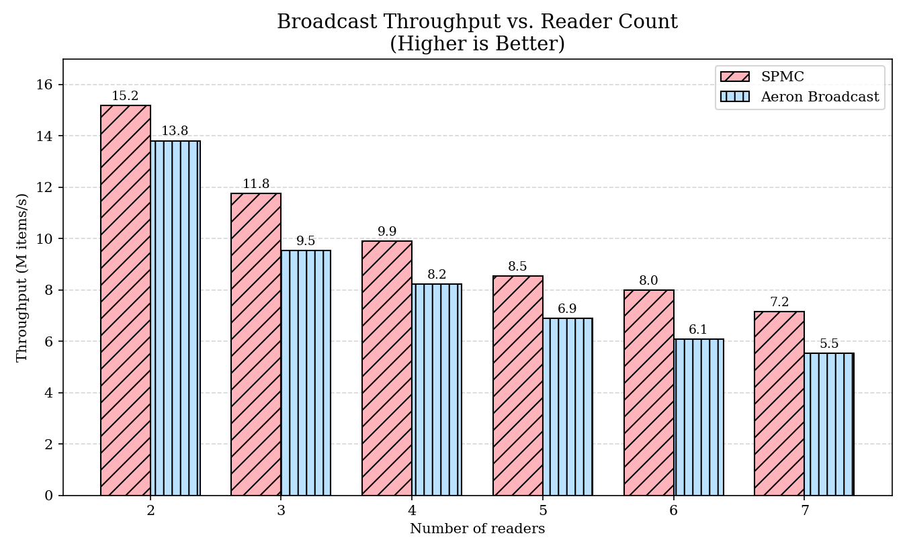

# Inspiration & Credit

[https://www.youtube.com/watch?v=sX2nF1fW7kI] When nanoseconds matter: Ultrafast Trading Systems in C++ - David Gross - CppCon 2024

# Usage:

```cmake
include(FetchContent)
FetchContent_Declare(multiqueues
    GIT_REPOSITORY https://github.com/TrevorSemeraro/MessageQueues.git
    GIT_TAG master)
FetchContent_MakeAvailable(queues)

target_link_libraries(my_app PRIVATE multiqueues)
```

```cpp
#include <multiqueues/spsc.hpp>

using namespace MultiQueues;

// Producer process. capacity is in bytes: a power of two, at least 4 cache lines.
// Fails if "/orders" already exists; this queue unlinks it when destroyed.
auto queue = SPSC::create(SharedMemory{"/orders"}, 1 << 20);
auto producer = create_producer(queue);

Order parsed_result;
producer.write(sizeof(Order), Order::QueueType, [&](std::span<std::byte> buf) {
    // encode directly into the queue
    std::memcpy(buf.data(), &parsed_result, sizeof(Order));
});

// Consumer process. Capacity is read from the queue header.
auto queue = SPSC::attach(SharedMemory{"/orders"});
auto consumer = create_consumer(queue);

consumer.read([&](MessageHeader hdr, std::span<std::byte> buf) {
    switch (hdr.type) {
    case Order::QueueType: {
        Order o;
        std::memcpy(&o, buf.data(), sizeof(Order));
        break;
    }
    }
});
```

Backings: `Heap{}` (one process), `SharedMemory{name}` (between processes) and
`Region{ptr, size}` (memory you manage yourself).

Queues: `SPSC`, `SPMC` (consumers can be lapped) and `MPSC`. Creating a second producer
or consumer where only one is allowed throws `std::logic_error`, unless the process
holding that role has died, in which case the role is reclaimed.

# Performance:

Cache Line aware counters

For optimal performance in productino environment, use HUGEPAGE's for the ring buffer. at 4Kb default pages, a 2MB (default setting) ring buffer allocates 500 pages. L2 TLB typically holds between 1024 and 2048 entries, meaning it will be evicting roughly 1/4 to 1/2 of the pages in the l2 tlb.

